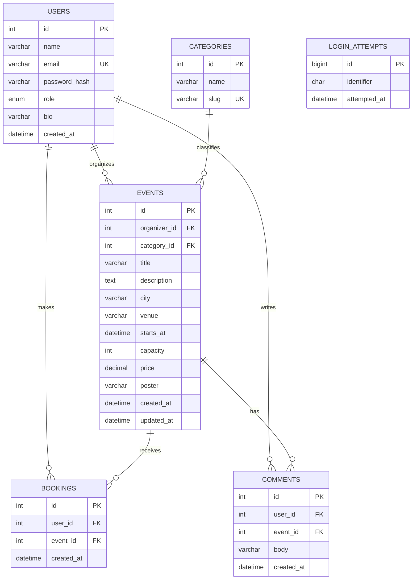

# Дерекқор құрылымы

Бес негізгі кесте сыртқы кілттермен байланысады. Алтыншы `login_attempts` кестесі сәтсіз кіру әрекеттерін шектеуге қажет. Нақты типтер мен шектеулер `database/schema.sql` файлында анықталған.

| Кесте | Мақсаты |
| --- | --- |
| `users` | Есім, бірегей email, құпиясөз хеші, рөл және профиль мәтіні |
| `categories` | Музыка, спорт, шеберлік сабақтары сияқты санаттар |
| `events` | Ұйымдастырушысы, санаты, уақыты және сыйымдылығы бар іс-шаралар |
| `bookings` | Қатысушы мен іс-шара байланысы; `user_id + event_id` жұбы бірегей |
| `comments` | Пайдаланушының іс-шараға жазған пікірі |
| `login_attempts` | Сәтсіз кіру уақыты және email/IP жұбының SHA-256 идентификаторы |

Бір ұйымдастырушы бірнеше іс-шара жасай алады; әр іс-шараның бір ұйымдастырушысы бар. Санат бөлек кестеде сақталады, сондықтан оның атауы әр жазбада қайталанып енгізілмейді.

Қатысушылар мен іс-шаралар `bookings` арқылы «көптен көпке» байланысады. Бірегей индекс бір адамның бір іс-шараға қайта жазылуына жол бермейді. Қатысушылар саны нақты жазылулардан есептеледі.

Пікір пайдаланушыға да, іс-шараға да тиесілі. Сыртқы кілттер деректердің тұтастығын сақтайды. Іс-шара жойылғанда, оған қатысты жазылулар мен пікірлер каскадты жойылады. Сыйымдылықты, уақытты және құқықтарды тексеру PHP-де де орындалады.

`login_attempts` пайдаланушыға сыртқы кілтпен байланыспайды: қате әрекет тіркелмеген email-ге де жасалуы мүмкін. Уақыт индексі соңғы 15 минуттағы әрекеттерді санауға көмектеседі.

Кестелер InnoDB және қазақша/орысша таңбаларға арналған `utf8mb4` кодтауын қолданады. PDO сұраныстарына мәндер параметрлер арқылы беріледі.
